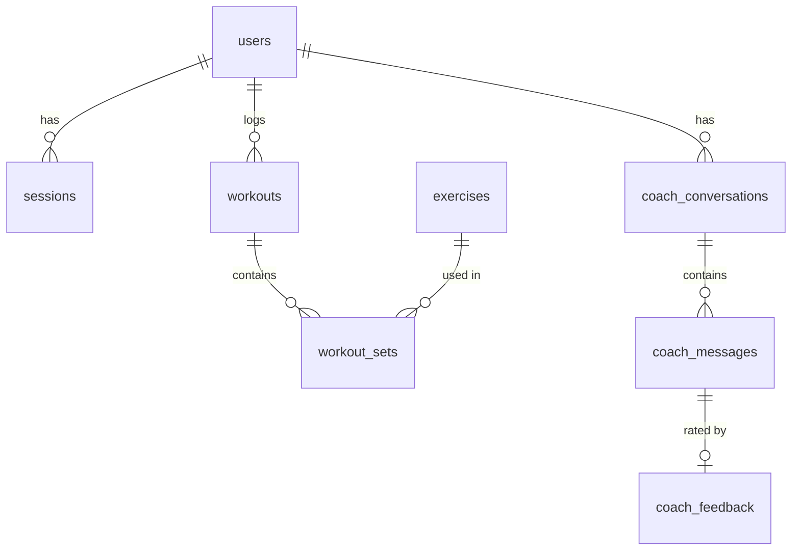

# Database schema

SQLite through SQLAlchemy (`app/db.py`). Generated from the code, so it matches the running app. Deleting a
user deletes their sessions, workouts, sets, conversations, messages and feedback (right to erasure).

## audit_log

Account events and admin actions. Usernames only, never training data.

| Column | Type | Required | Notes |
|---|---|---|---|
| `id` | INTEGER | yes | primary key |
| `time` | DATETIME | yes |  |
| `actor` | VARCHAR(30) | yes |  |
| `action` | VARCHAR(40) | yes |  |
| `target` | VARCHAR(60) | yes |  |

## exercises

The exercise library: 876 exercises from free-exercise-db, descriptions from megaGym.

| Column | Type | Required | Notes |
|---|---|---|---|
| `id` | VARCHAR(100) | yes | primary key |
| `name` | VARCHAR(200) | yes |  |
| `primary_muscles` | VARCHAR(200) | yes |  |
| `secondary_muscles` | VARCHAR(200) | yes |  |
| `equipment` | VARCHAR(50) | yes |  |
| `level` | VARCHAR(20) | yes |  |
| `category` | VARCHAR(30) | yes |  |
| `description` | TEXT | no |  |

## users

An account. No name or e-mail. Training profile empty for an admin-only account.

| Column | Type | Required | Notes |
|---|---|---|---|
| `id` | INTEGER | yes | primary key |
| `username` | VARCHAR(30) | yes | unique |
| `password_hash` | VARCHAR(200) | yes | PBKDF2-SHA256, 600,000 rounds, random salt |
| `role` | VARCHAR(10) | yes | user or admin |
| `is_demo` | BOOLEAN | yes |  |
| `created_at` | DATETIME | yes |  |
| `last_login_at` | DATETIME | no |  |
| `failed_logins` | INTEGER | yes |  |
| `locked_until` | DATETIME | no | set after 5 wrong passwords, for 15 minutes |
| `consent_health_at` | DATETIME | no | explicit consent for training data (GDPR art. 9) |
| `consent_ai_coach` | BOOLEAN | yes | separate, optional consent for the AI coach |
| `consent_version` | VARCHAR(10) | no |  |
| `age` | INTEGER | no |  |
| `gender` | VARCHAR(10) | no |  |
| `height_cm` | FLOAT | no |  |
| `weight_kg` | FLOAT | no |  |
| `goal` | VARCHAR(30) | no |  |
| `experience` | VARCHAR(15) | no |  |
| `weekly_target` | INTEGER | no | training days a week, 1-7 |

## coach_conversations

One chat with the AI coach.

| Column | Type | Required | Notes |
|---|---|---|---|
| `id` | INTEGER | yes | primary key |
| `user_id` | INTEGER | yes | → users.id |
| `started_at` | DATETIME | yes |  |
| `title` | VARCHAR(120) | yes |  |

## sessions

A login; only the SHA-256 hash of the token is stored. Expires after 8 hours.

| Column | Type | Required | Notes |
|---|---|---|---|
| `id` | INTEGER | yes | primary key |
| `user_id` | INTEGER | yes | → users.id |
| `token_hash` | VARCHAR(64) | yes | unique; SHA-256 of the login token |
| `created_at` | DATETIME | yes |  |
| `expires_at` | DATETIME | yes |  |

## workouts

One training session.

| Column | Type | Required | Notes |
|---|---|---|---|
| `id` | INTEGER | yes | primary key |
| `user_id` | INTEGER | yes | → users.id |
| `date` | DATE | yes |  |
| `start_time` | TIME | no |  |
| `focus` | VARCHAR(80) | no | e.g. "chest, arms" |
| `duration_min` | INTEGER | no |  |
| `rpe` | INTEGER | no | how hard it felt, 1-10 |

## coach_messages

A question or an answer, with the model, prompt version, response time and what the model saw.

| Column | Type | Required | Notes |
|---|---|---|---|
| `id` | INTEGER | yes | primary key |
| `conversation_id` | INTEGER | yes | → coach_conversations.id |
| `time` | DATETIME | yes |  |
| `role` | VARCHAR(10) | yes | user or assistant |
| `content` | TEXT | yes |  |
| `model` | VARCHAR(60) | no |  |
| `prompt_version` | VARCHAR(10) | no |  |
| `latency_ms` | INTEGER | no |  |
| `context` | TEXT | no | JSON: goal, experience and calculated progress; no personal details |

## workout_sets

One set. Reps and weight for weights and bodyweight; duration (and level) for holds and cardio.

| Column | Type | Required | Notes |
|---|---|---|---|
| `id` | INTEGER | yes | primary key |
| `workout_id` | INTEGER | yes | → workouts.id |
| `exercise_id` | VARCHAR(100) | yes | → exercises.id |
| `set_number` | INTEGER | yes |  |
| `reps` | INTEGER | yes | 0 for holds and cardio |
| `weight_kg` | FLOAT | yes | extra weight for bodyweight exercises |
| `duration_s` | INTEGER | no | holds and cardio |
| `level` | INTEGER | no | cardio, 1-10 |

## coach_feedback

A user's rating of one answer.

| Column | Type | Required | Notes |
|---|---|---|---|
| `id` | INTEGER | yes | primary key |
| `message_id` | INTEGER | yes | → coach_messages.id; unique |
| `rating` | INTEGER | yes | +1 helpful, -1 not helpful |
| `reason` | VARCHAR(30) | no |  |
| `comment` | VARCHAR(500) | no |  |
| `created_at` | DATETIME | yes |  |
